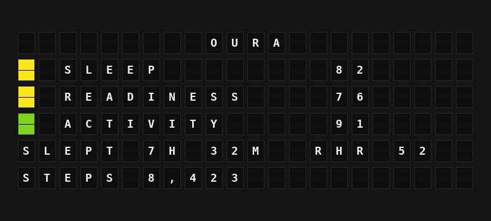

# Oura Plugin

Show your Oura Ring's daily Sleep, Readiness and Activity scores, last night's sleep, and today's steps.



**→ [Setup Guide](./docs/SETUP.md)**

## Overview

The Oura plugin reads your data through the Oura API v2 and turns it into board-ready variables: the three daily scores with a colour tile for each (green 85+, yellow 70-84, red below 70, the same bands the Oura app uses), last night's total sleep, resting heart rate, HRV and bedtime, and today's steps and calories.

You sign in once with FiestaBoard's **Sign in with Oura** button, using a free Oura API application that you register for yourself (Oura limits an unapproved application to 10 users, so each person brings their own; the plugin's settings walk you through it). FiestaBoard keeps the sign-in fresh. Oura retired personal access tokens in December 2025, so signing in is the only way to connect. Requires FiestaBoard 9.8.0 or later.

## Template Variables

### Daily Scores

| Variable | Description | Example |
|----------|-------------|---------|
| `{{oura.sleep_score}}` | Latest daily Sleep score, 0-100 | `82` |
| `{{oura.sleep_tile}}` | Colour tile for the Sleep score | `{65}` |
| `{{oura.sleep_label}}` | `OPTIMAL`, `GOOD` or `PAY ATTENTION` | `GOOD` |
| `{{oura.readiness_score}}` | Latest daily Readiness score, 0-100 | `76` |
| `{{oura.readiness_tile}}` | Colour tile for the Readiness score | `{65}` |
| `{{oura.readiness_label}}` | `OPTIMAL`, `GOOD` or `PAY ATTENTION` | `GOOD` |
| `{{oura.activity_score}}` | Latest daily Activity score, 0-100 | `91` |
| `{{oura.activity_tile}}` | Colour tile for the Activity score | `{66}` |
| `{{oura.activity_label}}` | `OPTIMAL`, `GOOD` or `PAY ATTENTION` | `OPTIMAL` |
| `{{oura.scores_line}}` | All three scores on one line | `SLP 82 RDY 76 ACT 91` |

### Last Night's Sleep

| Variable | Description | Example |
|----------|-------------|---------|
| `{{oura.total_sleep}}` | Total sleep | `7H 32M` |
| `{{oura.total_sleep_minutes}}` | Total sleep in minutes | `452` |
| `{{oura.time_in_bed}}` | Time in bed | `8H 5M` |
| `{{oura.deep_sleep}}` | Deep sleep | `1H 30M` |
| `{{oura.rem_sleep}}` | REM sleep | `1H 50M` |
| `{{oura.sleep_efficiency}}` | Percent of time in bed asleep | `93` |
| `{{oura.resting_hr}}` | Lowest heart rate during sleep (bpm) | `52` |
| `{{oura.average_hr}}` | Average heart rate during sleep (bpm) | `58` |
| `{{oura.average_hrv}}` | Average HRV during sleep (ms) | `48` |
| `{{oura.bedtime}}` | When sleep started, 24-hour | `22:48` |
| `{{oura.wake_time}}` | When sleep ended, 24-hour | `06:53` |

### Activity Today

| Variable | Description | Example |
|----------|-------------|---------|
| `{{oura.steps}}` | Steps today | `8423` |
| `{{oura.steps_text}}` | Steps with a thousands separator | `8,423` |
| `{{oura.active_calories}}` | Active calories | `412` |
| `{{oura.total_calories}}` | Total calories | `2310` |

### Body

| Variable | Description | Example |
|----------|-------------|---------|
| `{{oura.temperature_deviation}}` | Temperature deviation from your baseline (°C) | `+0.2` |

A value Oura has not calculated yet (for example, today's Sleep score before you open the Oura app) is empty.

## Example Templates

### Daily scores (Flagship)

```
OURA
{{oura.sleep_tile}} SLEEP {{oura.sleep_score}}
{{oura.readiness_tile}} READINESS {{oura.readiness_score}}
{{oura.activity_tile}} ACTIVITY {{oura.activity_score}}
SLEPT {{oura.total_sleep}} RHR {{oura.resting_hr}}
STEPS {{oura.steps_text}}
```

### Last night (Flagship)

```
LAST NIGHT
SLEPT {{oura.total_sleep}}
IN BED {{oura.bedtime}} - {{oura.wake_time}}
RESTING HR {{oura.resting_hr}} BPM
HRV {{oura.average_hrv}} MS
TEMP {{oura.temperature_deviation}}
```

### Note

```
{{oura.sleep_tile}} SLEEP {{oura.sleep_score}}
{{oura.readiness_tile}} READINESS {{oura.readiness_score}}
{{oura.activity_tile}} ACTIVITY {{oura.activity_score}}
```

## Configuration

| Setting | Type | Default | Description |
|---------|------|---------|-------------|
| `enabled` | boolean | `false` | Enable the plugin |
| `client_id` | string | | Client ID of your own Oura API application (entered under Account connection) |
| `client_secret` | string (password) | | Client Secret of the same application (entered under Account connection) |
| `refresh_seconds` | integer | `600` | How often to ask Oura for new data (300-3600) |

## Features

- Daily Sleep, Readiness and Activity scores with Oura's colour bands
- Last night's main sleep: total, stages, resting heart rate, HRV, efficiency, bedtime and wake time
- Today's steps and calories, and body temperature deviation
- Sign in with your own Oura API application; FiestaBoard stores and refreshes the tokens (Oura refresh tokens are single-use, and FiestaBoard keeps the newest one)
- One request per data type shared between boards, a cooldown after errors, `Retry-After` honoured on rate limits, and the last good data kept through short outages

## Author

FiestaBoard Team
